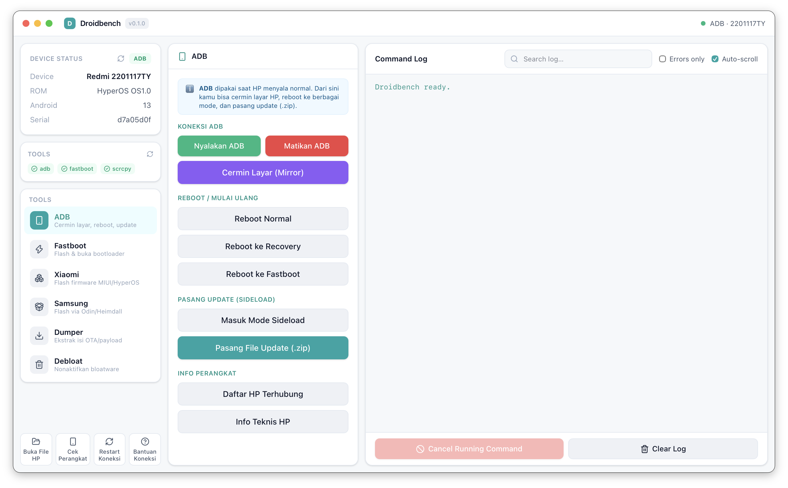
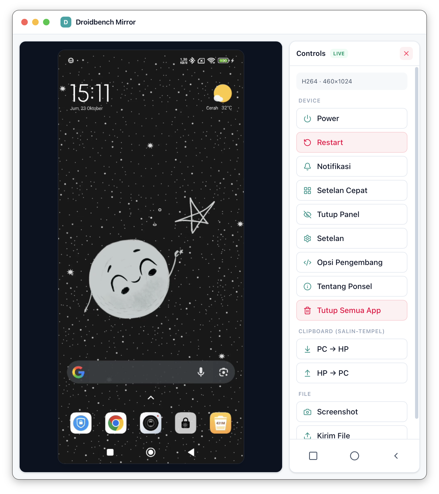

<div align="center">

# Droidbench

### Satu aplikasi desktop untuk semua urusan oprek & servis HP — ramah pemula.

Android **dan** iOS. Flashing · Servis · Debloat · Diagnostik (cek HP bekas) ·
**Mirror Layar (Live Mirror, Android)** — untuk **macOS · Windows · Linux** dari
satu codebase.

Dibangun dengan **Tauri 2 + React 19 + TypeScript + Tailwind v4 + Rust**.
Semua tool CLI (adb · fastboot · scrcpy · libimobiledevice) **dibundel** di
dalam aplikasi — tidak perlu install apa-apa lagi di laptop pengguna.


</div>

---

<div align="center">

### Tampilan Utama — 3 kolom: navigasi · panel tool · log



### Mirror Layar (Live Mirror) — layar HP Android real-time + panel kontrol



</div>

---

## Fitur utama

- **Android & iOS.** Perangkat terdeteksi otomatis (adb untuk Android,
  libimobiledevice untuk iPhone/iPad) dan UI menyesuaikan sendiri.
- **Diagnostik "cek HP bekas"** ala 3uTools: skor kesehatan, kesehatan baterai,
  info perangkat, keaslian/bootloader/root, estimasi Play Integrity 3-tier
  (Android), serta baterai + info + penyimpanan + IMEI (iOS).
- **Mirror Layar (Live Mirror)** Android tertanam — layar HP tampil & bisa
  dikontrol di dalam window Droidbench. H.264 di-decode di Rust (OpenH264),
  jadi tidak bergantung pada codec WebView.
  **iOS tidak punya live mirror** — Apple membatasinya ke QuickTime/Finder,
  dan tidak ada jalur fps-layak untuk aplikasi pihak ketiga di macOS/iOS saat
  ini. Untuk iOS sediakan **Tangkapan Layar (screenshot)** read-only.
- **iOS Tools** (lewat libimobiledevice, tanpa jailbreak): **backup & restore**
  penuh (idevicebackup2), **log konsol langsung** + **salin laporan crash**
  (idevicesyslog / idevicecrashreport), dan **pasang/copot aplikasi** `.ipa`
  (ideviceinstaller).
- **Checklist perangkat keras** + rekomendasi aplikasi tes open-source (sebagian
  APK ikut dibundel & bisa dipasang via USB sekali klik).
- **Flashing** Fastboot / Xiaomi / Samsung (Heimdall) + ekstraksi `payload.bin`.
- **Debloat** reversible (`pm disable-user`) dengan database paket per-merek.
- **Dwibahasa** Indonesia / English, bisa diganti kapan saja.
- **Auto-update** bawaan (Tauri updater, paket ber-tanda-tangan).
- Semua tool **dibundel** → hapus aplikasi = semua ikut terhapus (plug-and-play,
  tidak menyebar file ke sistem).

## Tab

Dikelompokkan jadi dua grup: **Perangkat** dan **Flashing**.

| Tab | Fungsi |
|-----|--------|
| **Layar & Kontrol** | Mirror Layar Android (scrcpy) & screenshot iOS, start/kill ADB, reboot ke berbagai mode, pasang ZIP, screenshot/rekam layar, wireless ADB |
| **iOS Tools** | iPhone/iPad: backup & restore, log konsol langsung, salin laporan crash, pasang/copot aplikasi `.ipa` (libimobiledevice) |
| **Diagnostik** | Cek HP bekas: skor, baterai, sensor, keaslian, Play Integrity (Android) — otomatis beralih ke panel iOS (baterai health, info, storage, IMEI) saat iPhone tersambung |
| **Aplikasi** | Daftar & kelola aplikasi terpasang, pasang APK dan bundle **XAPK / APKM / APKS** (split APK + file OBB dipasang otomatis), blokir/aktifkan market handler |
| **Logcat** | Log Android real-time, filter per-aplikasi, simpan/bugreport |
| **Koneksi/DNS** | Toggle WiFi/data/airplane, atur Private DNS |
| **Developer** | Stress test/monkey, cold-start, overlay overdraw/layout/pointer, dll |
| **Fastboot** | Panduan: sambung, status bootloader (terbaca otomatis), daftar yang perlu diunduh. Tool: getvar, flash partisi, temp-boot, slot A/B, disable verity/vbmeta, unlock/lock |
| **Xiaomi** | Dari stock Xiaomi: sambung → Mi Unlock resmi → pilih firmware resmi (`flash_all`) atau custom ROM → flash → verifikasi |
| **Samsung (Heimdall)** | Panduan bertahap: mode Download, bootloader (untuk custom ROM/root), firmware, flash slot BL/AP/CP/CSC |
| **Pixel, OnePlus, Motorola, Sony, Oppo/Realme, Vivo/iQOO, Huawei/Honor, ASUS, Nothing** | Satu tab per merek dengan logonya, formatnya sama dengan Xiaomi dan Samsung: cara unlock resmi (atau terus terang bila tidak ada), sumber firmware resmi, catatan flashing. Merek lain (Tecno, Infinix, Lenovo, dll) ada di tab Fastboot, langkah "Merek lain" |
| **Custom ROM** | Dari custom ROM ke ROM lain: tutorial unlock per merek, custom recovery (OrangeFox/TWRP), clean vs dirty flash, install/sideload ZIP |
| **Root (Magisk)** | Patch boot/init_boot dengan Magisk resmi, flash, verifikasi root |
| **Dumper** | ekstrak image partisi dari OTA `payload.bin` / ZIP |

---

## Build di laptop sendiri (untuk kontributor)

Tauri **tidak bisa cross-compile** — tiap OS harus di-build di OS-nya sendiri
(Windows di Windows, macOS di macOS, Linux di Linux).

### 1. Prasyarat (semua OS)

- **Node.js 20+** dan npm
- **Rust (stable)** via [rustup](https://rustup.rs)
- **NASM** (untuk kompilasi OpenH264 dari source)

Tambahan per-OS:

- **macOS**: Xcode Command Line Tools (`xcode-select --install`),
  [Homebrew](https://brew.sh) (untuk mem-bundel tool iOS: `libimobiledevice`
  + `ideviceinstaller`).
- **Windows**: Microsoft C++ Build Tools (Desktop C++) + WebView2 (sudah ada di
  Win 11). NASM: `choco install nasm` atau installer resmi.
- **Linux (Debian/Ubuntu)**:
  ```bash
  sudo apt-get update
  sudo apt-get install -y libwebkit2gtk-4.1-dev libappindicator3-dev \
    librsvg2-dev patchelf nasm build-essential curl wget file
  ```

### 2. Ambil dependensi

```bash
git clone https://github.com/mhmmdadipur/droidbench.git
cd droidbench
npm install
```

### 3. Siapkan tool CLI yang dibundel

Binary CLI **tidak ikut di git** (terlalu besar / per-platform). Ambil dulu
sesuai OS-mu:

```bash
# adb, fastboot, scrcpy, scrcpy-server (otomatis sesuai OS)
bash scripts/fetch-binaries.sh            # auto-detect
# atau paksa platform saat packaging:
bash scripts/fetch-binaries.sh mac
bash scripts/fetch-binaries.sh win
bash scripts/fetch-binaries.sh linux
```

Tool iOS (idevice*) butuh langkah khusus karena dynamically-linked:

- **macOS** — install libimobiledevice (+ ideviceinstaller untuk pasang/copot
  aplikasi) lalu bundel + rewrite dylib ke dalam app:
  ```bash
  brew install libimobiledevice ideviceinstaller
  bash scripts/bundle-imobiledevice-mac.sh    # → src-tauri/binaries/imd/
  ```
  (Dipanggil otomatis oleh `fetch-binaries.sh mac` bila libimobiledevice ada.
  `ideviceinstaller` formula terpisah — kalau belum ada, langkah pasang/copot
  aplikasi iOS dilewati, sisanya tetap jalan.)
- **Windows** — `fetch-binaries.sh win` mengunduh build `imobiledevice-net`
  (exe + DLL) ke `src-tauri/binaries/imd/`. Pengguna tetap perlu **Apple Mobile
  Device Support** (driver USB; dari iTunes/Apple Devices).
- **Linux** — `sudo apt install libimobiledevice-utils ideviceinstaller`,
  diresolusi dari sistem.

Database debloat sudah ter-commit; untuk menyegarkan: `bash scripts/gen-databases.sh`.

### 4. Jalankan / build

```bash
npm run tauri dev                      # mode dev (hot-reload)
npm run tauri build                    # installer untuk OS saat ini
npm run tauri build -- --bundles app   # macOS .app saja (lewati .dmg)
```

Hasil build:

- **macOS** → `.app` + `.dmg` di `src-tauri/target/release/bundle/`
- **Windows** → `.msi` + `.exe` (NSIS) — keduanya terdaftar di Add/Remove Programs
- **Linux** → `.AppImage` + `.deb`

### Verifikasi sebelum commit

```bash
npx tsc --noEmit                                  # type-check frontend
npm run build                                     # bundle frontend
cargo check --manifest-path src-tauri/Cargo.toml  # type-check Rust
```

---

## Mirror Layar (cara kerja)

Klik **Mirror Android Screen** → window terpisah berisi layar HP (klik/geser/
scroll untuk mengontrol) + panel kontrol (Power, Notifikasi, Clipboard PC↔HP,
Screenshot, Push File, nav Recents/Home/Back).

**Keyboard & clipboard:** ketik langsung dengan keyboard laptop (semua layout,
termasuk huruf beraksen dan IME). Enter, Backspace, Delete, Tab, panah, Home/End,
PageUp/PageDown dikirim sebagai tombol; Esc = Back. Ctrl/Cmd+C/X salin dari HP
ke clipboard komputer, Ctrl/Cmd+V tempel dari komputer ke HP, Ctrl/Cmd+A pilih
semua, Ctrl/Cmd+Z undo. Salin di HP (lewat sentuhan) juga otomatis masuk ke
clipboard komputer. Clipboard komputer diakses native lewat crate `arboard`
(bukan API clipboard WebView yang sering ditolak).

**Fitur lain di jendela mirror:** tombol Volume +/-, putar layar, matikan layar
HP selama mirror, Aplikasi Terbaru, Notifikasi/Setelan Cepat; klik kanan = Back,
klik tengah = Home, Shift+geser = pinch-zoom; seret file ke jendela (APK/XAPK
dipasang, file lain dikirim ke Download); pilihan kualitas (Hemat/Seimbang/
Tajam); **suara HP diteruskan ke komputer** (PCM mentah lewat Web Audio, butuh
Android 11+); rekam layar ke MP4 (tanpa suara, dipecah per 3 menit); salin
tampilan layar ke clipboard.

**Keyboard Fisik (setara `scrcpy -K`):** jendela mirror bisa membuat keyboard USB
virtual di HP (UHID), sehingga keyboard laptop dikenali HP sebagai keyboard
sungguhan dan **keyboard layar HP tidak muncul**. Yang dikirim adalah scancode,
jadi karakternya mengikuti layout keyboard fisik di HP; Cmd di Mac dikirim
sebagai Ctrl. Jendela mirror juga **menutup sendiri saat HP dicabut**.

Teknis: Droidbench jadi *client* scrcpy — push `scrcpy-server` ke HP, buka adb
reverse tunnel, baca stream H.264 Annex-B (`send_frame_meta=false`), decode tiap
NAL unit dengan **OpenH264** ke RGBA di Rust, kirim ke `<canvas>` lewat Tauri
Channel (raw bytes, bukan base64 — rendah latensi). Input dikirim balik lewat
control socket scrcpy.

Mirror live **iOS tidak tersedia**: Apple membatasi perekaman layar iPhone ke
QuickTime/Finder (protokol usbmux khusus), dan tidak ada jalur fps-layak untuk
aplikasi pihak ketiga di macOS/iOS saat ini (MJPEG via libimobiledevice hanya
~1–2 fps). Untuk iOS pakai **Tangkapan Layar** read-only di tab Layar & Kontrol.

Logo merek di tab Flashing berasal dari [simple-icons](https://simpleicons.org) (CC0). Nama dan logo merek adalah merek dagang pemiliknya masing-masing dan dipakai hanya untuk menunjukkan panduan itu untuk merek mana; Droidbench tidak berafiliasi dengan mereka.

## Rilis (hybrid, satu release untuk semua OS)

Lihat [`.github/workflows/`](.github/workflows/). Windows & Linux dibangun CI;
macOS dibangun CI juga (workflow `release-mac.yml`) **atau** lokal lewat
`scripts/release-mac.sh`. Semua artifact (`.dmg`/`.app.tar.gz` mac,
`.exe`/`.msi` windows, `.AppImage`/`.deb` linux) masuk ke **satu** GitHub Release
per tag `vX.Y.Z`.

Bump `version` di `src-tauri/tauri.conf.json` + `package.json`, lalu:

```bash
git tag vX.Y.Z && git push origin vX.Y.Z
```

## Auto-update

Droidbench memakai updater bawaan Tauri. Saat start ia cek
`releases/latest/download/latest.json`; bila ada versi **ber-tanda-tangan** yang
lebih baru, tombol **Update → vX.Y.Z** muncul. Hanya paket yang ditandatangani
yang dipasang.

Setup kunci (sekali):

```bash
npm run tauri signer generate -- -w ~/.droidbench-keys/droidbench.key --password ''
```

- Public key sudah tertanam di `src-tauri/tauri.conf.json` (`plugins.updater.pubkey`).
- Private key untuk CI → simpan di GitHub secrets:
  - `TAURI_SIGNING_PRIVATE_KEY` = isi `~/.droidbench-keys/droidbench.key`
  - `TAURI_SIGNING_PRIVATE_KEY_PASSWORD` = password (kosong di sini)

## Struktur proyek

```
src/
  App.tsx                       shell layout + routing window (?view=mirror/explorer/setup)
  components/
    DeviceStatus.tsx            kartu status perangkat (Android & iOS)
    ToolsBar.tsx                ringkasan 7 tool + popup info
    LogPanel.tsx                log streaming dengan pencarian
    SetupWizard.tsx             panduan koneksi (Android & iOS)
    LicenseModal.tsx            Terms + notice lisensi pihak ketiga
    tabs/*.tsx                  Layar&Kontrol / Diagnostik / Aplikasi / Logcat / ...
    tabs/IosTab.tsx             panel diagnostik iOS
    mirror/*.tsx                window cermin layar + kontrol
    ui/*.tsx                    Button, Modal, Section/Row
  state/                        context: device / log / tools / diagnostic / iosDiagnostic / ...
  lib/                          api.ts, mirrorApi.ts, diagnostics.ts, ...
  i18n/                         en.ts + id.ts (kunci harus sama persis)
src-tauri/
  src/runner.rs                 spawn proses + streaming + resolusi tool
  src/device.rs                 deteksi perangkat (adb/fastboot/heimdall/iOS)
  src/ios.rs                    diagnostik iOS (ideviceinfo/idevicediagnostics) + screenshot
  src/mirror.rs                 scrcpy + decode OpenH264 → frame
  src/control.rs                pesan kontrol scrcpy
  binaries/                     adb/fastboot/scrcpy (+ imd/ untuk tool iOS; tidak di-git)
  licenses/                     teks lisensi pihak ketiga yang dibundel
scripts/
  fetch-binaries.sh             unduh adb/fastboot/scrcpy (+ iOS win)
  bundle-imobiledevice-mac.sh   bundel idevice* + dylib ke binaries/imd (macOS)
  gen-databases.{sh,mjs}        generate database debloat
  release-mac.sh                build + sign mac untuk rilis
  merge-latest-json.mjs         gabungkan latest.json lintas platform
```

## Kredit & lisensi

Data debloat (MIT):

- [MiDebloat-Remover](https://github.com/myruldev/MiDebloat-Remover) — myruldev
- [Android-Universal-Debloat](https://github.com/myruldev/Android-Universal-Debloat) — myruldev
- [tv-detox](https://github.com/Ansub/tv-detox) — Ansub

Tool & aplikasi yang dibundel (lihat `src-tauri/licenses/THIRD-PARTY-LICENSES.txt`):

- Android platform-tools adb/fastboot (Google, Apache-2.0)
- [scrcpy](https://github.com/Genymobile/scrcpy) (Genymobile, Apache-2.0)
- [OpenH264](https://github.com/cisco/openh264) (Cisco) via crate `openh264`
- [libimobiledevice](https://github.com/libimobiledevice/libimobiledevice) (LGPL-2.1) — tool iOS
- [InjuredPixels](https://github.com/aurelitec/injuredpixels-android) (Apache-2.0) — APK tes layar
- [Hardware Testing](https://github.com/rohanagarwal94/Hardware-testing) (MIT) — APK tes hardware

Droidbench sendiri berlisensi **MIT**.

## Keamanan & tanggung jawab

Debloat memakai `pm disable-user` — reversible, tidak ada yang di-uninstall.
Flashing, membuka bootloader, dan menonaktifkan verity bisa membuat perangkat
brick atau menghanguskan garansi. Gunakan hanya pada perangkat milikmu sendiri.
Kamu bertanggung jawab atas apa yang kamu lakukan. Semua fitur iOS bersifat
**read-only** (tidak ada jailbreak, tidak mengubah perangkat).
