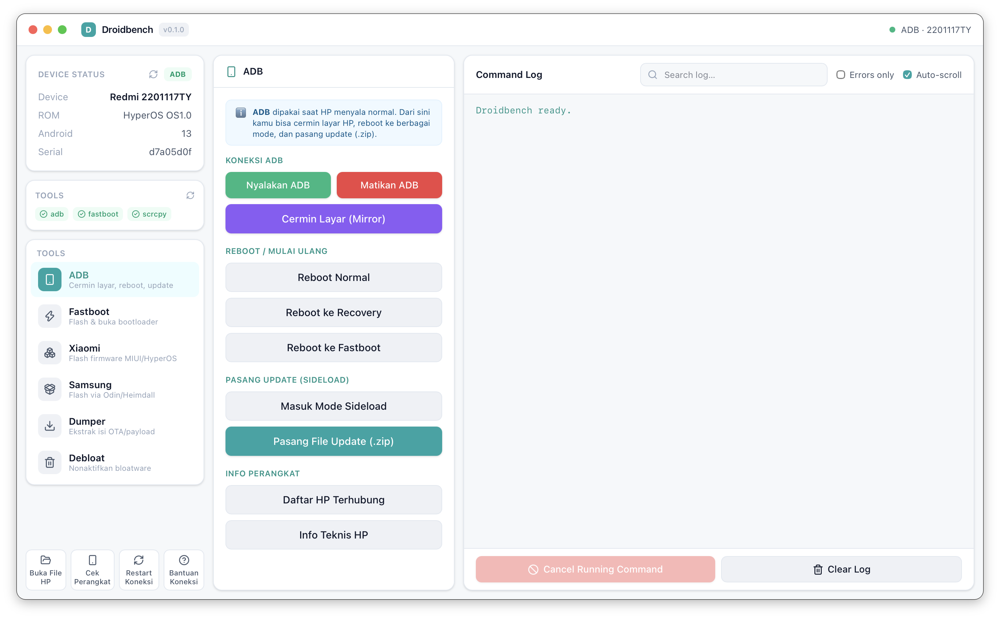
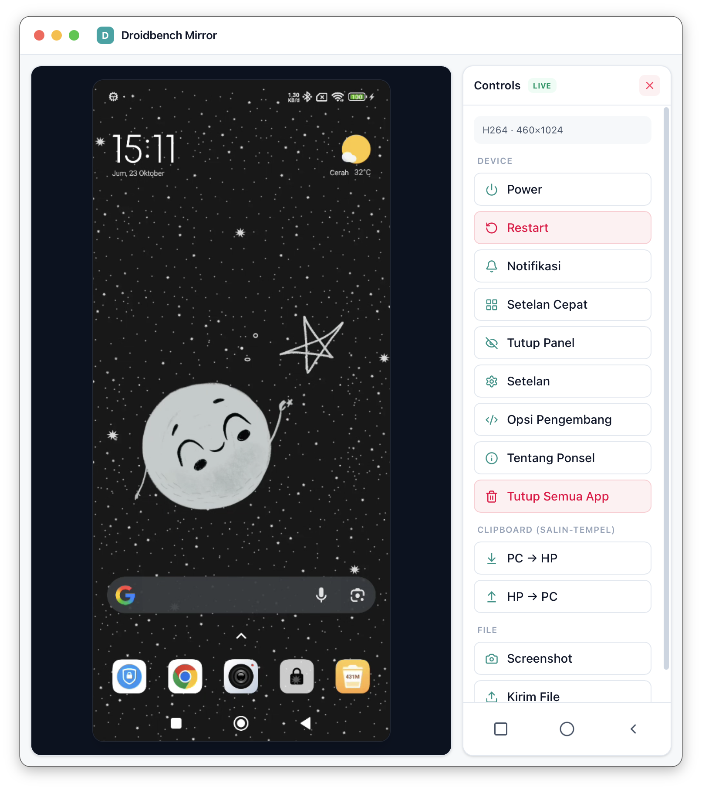

<div align="center">

# 🤖 Droidbench

### Satu aplikasi desktop untuk semua urusan oprek Android — ramah pemula.

Flashing · Servicing · Debloat · **Cermin Layar (Live Mirror)** — untuk
**macOS & Windows** dari satu codebase.
Dibangun dengan **Tauri 2 + React 19 + Tailwind v4**. Tool CLI (adb · fastboot ·
heimdall · payload-dumper · **scrcpy**) sudah **dibundel** — tinggal copy ke
laptop lain dan klik.


</div>

---

<div align="center">

### 🖥️ Tampilan Utama — 3 kolom lega: navigasi · panel tool · log



### 📱 Cermin Layar (Live Mirror) — layar HP real-time + panel kontrol dalam satu window



</div>

---

## ✨ Sorotan

- 🟢 **Window ber-traffic-light ala macOS** (merah/kuning/hijau) di macOS *dan*
  Windows. UI terang, segar, aksen teal, sudut membulat.
- 📊 **Status perangkat** otomatis + bar **Tools** yang menunjukkan tiap CLI
  bundled / dari sistem / belum ada.
- 📜 **Command log besar** dengan pencarian, filter error, auto-scroll.
- 📱 **Live mirror tertanam** — layar HP tampil & bisa dikontrol *di dalam
  window Droidbench sendiri*. H.264 di-decode di Rust (OpenH264), jadi **tidak
  bergantung** pada dukungan codec WebView.
- 🧭 **Ramah pemula** — tiap tab ada penjelasan, tiap tombol ada tooltip Bahasa
  Indonesia yang menjelaskan fungsinya.
- 🔄 **Auto-update** bawaan (lihat bagian Auto-update).

## 🧰 Tab

| Tab | Fungsi |
|-----|--------|
| **ADB** | start/kill server, reboot system/recovery/fastboot/sideload, pasang ZIP, **Cermin Layar**, daftar perangkat |
| **Fastboot** | getvar, flash boot/recovery/init_boot/vendor_boot/vbmeta, temp-boot, slot A/B, dis-verity/vbmeta, unlock/lock |
| **Xiaomi** | pilih folder firmware, jalankan flash_all, info Mi Unlock |
| **Samsung (Heimdall)** | detect, print-pit, slot BL/AP/CP/CSC/HOME/PIT, no-reboot/repartition, flash |
| **Dumper** | ekstrak image partisi dari OTA `payload.bin` / ZIP |
| **Debloat** | database paket Xiaomi / Universal (25 merek) / Android TV, diterapkan via ADB `pm disable-user` yang reversible |

## Live mirror

Clicking **Start Mirroring** opens a separate window containing the device
screen (click/drag/scroll to control it) plus a control panel:

- **Device**: Power, Restart, Notifications, Quick Settings, Hide Panels,
  Settings, Developer Options, About Phone, Clear Recents
- **Clipboard**: PC → Phone, Phone → PC
- **Files**: Screenshot (pull to a chosen folder), Push File
- **Nav bar**: Recents / Home / Back

How it works: Droidbench acts as the scrcpy *client*. It pushes `scrcpy-server`
to the device, opens an adb reverse tunnel, and reads the raw H.264 Annex-B
stream (`send_frame_meta=false` for a clean bitstream). Each NAL unit is decoded
with **OpenH264** to RGBA in Rust and blitted to a `<canvas>`. Input events are
sent back through scrcpy's control socket.

## Prerequisites (for building)

- Node 20+ and npm
- Rust (stable) via rustup
- macOS: Xcode Command Line Tools
- Windows: Microsoft C++ Build Tools + WebView2 (preinstalled on Win 11)

OpenH264 is compiled from source via `cc` / `nasm-rs`; no system codec needed.

## Setup

```bash
npm install

# generate debloat databases (committed; re-run to refresh)
bash scripts/gen-databases.sh

# fetch bundled adb/fastboot/scrcpy/scrcpy-server for your platform
bash scripts/fetch-binaries.sh            # auto-detect
bash scripts/fetch-binaries.sh win        # Windows .exe/.dll (when packaging for Windows)
```

`heimdall` and `payload-dumper` are optional — drop their executables into
`src-tauri/binaries/`. If a binary is not bundled, Droidbench resolves it from
common install locations / PATH.

## Develop / Build

```bash
npm run tauri dev                 # hot-reload dev
npm run tauri build               # .app + .dmg (macOS) / .msi + .exe (Windows)
npm run tauri build -- --bundles app   # macOS .app only (skips dmg packaging)
```

Tauri cannot cross-compile desktop apps — build the Windows installer on
Windows (run `scripts/fetch-binaries.sh win` first) and the macOS bundle on
macOS.

## Releases (hybrid: local macOS + CI Windows/Linux, one release)

To save CI minutes (the macOS runner costs 10× minutes), macOS is built locally
and Windows/Linux are built by GitHub Actions — all into **one** release:

1. Bump `version` in `src-tauri/tauri.conf.json`.
2. On your Mac: `bash scripts/release-mac.sh` → produces the `.dmg`.
3. `git tag vX.Y.Z && git push origin vX.Y.Z` → the
   [`release.yml`](.github/workflows/release.yml) workflow builds Windows + Linux
   and creates the GitHub Release for that tag.
4. Upload the local `.dmg` to that same release (web UI, or `gh release upload vX.Y.Z <dmg>`).

The release then contains `.dmg` (mac) + `.exe`/`.msi` (windows) +
`.AppImage`/`.deb` (linux). On a **public repo**, GitHub Actions is free, and no
macOS runner is used.

## Auto-update

Droidbench uses Tauri's built-in updater. On launch it checks
`https://github.com/mhmmdadipur/droidbench/releases/latest/download/latest.json`;
if a newer **signed** version exists, an **Update → vX.Y.Z** button appears next
to the version label. Clicking it downloads, verifies the signature, installs,
and relaunches.

- **macOS / Windows**: silent download + install + restart.
- **Linux (AppImage)**: the AppImage is replaced in place.

### One-time setup (signing keys)

The updater only installs **signed** packages. Generate a keypair once:

```bash
npm run tauri signer generate -- -w ~/.droidbench-keys/droidbench.key --password ''
```

- The **public key** is already embedded in `src-tauri/tauri.conf.json`
  (`plugins.updater.pubkey`). If you regenerate, update it.
- The **private key** signs releases. Keep it secret (never commit it). Add it
  to the repo's **GitHub secrets** for CI:
  - `TAURI_SIGNING_PRIVATE_KEY` = contents of `~/.droidbench-keys/droidbench.key`
  - `TAURI_SIGNING_PRIVATE_KEY_PASSWORD` = the password (empty here)

### Publishing an update (hybrid)

1. Bump `version` in `src-tauri/tauri.conf.json`.
2. `bash scripts/release-mac.sh` → signed macOS `.dmg` + `.app.tar.gz` + `.sig`.
3. `git tag vX.Y.Z && git push origin vX.Y.Z` → CI builds Windows/Linux and
   writes `latest.json` (win+linux) to the release.
4. Upload the macOS `.dmg`, `.app.tar.gz`, and `.app.tar.gz.sig` to that release.
5. Merge the macOS entry into `latest.json`:
   ```bash
   node scripts/merge-latest-json.mjs latest.json \
     src-tauri/target/release/bundle/macos/Droidbench.app.tar.gz.sig \
     https://github.com/mhmmdadipur/droidbench/releases/download/vX.Y.Z/Droidbench.app.tar.gz \
     > latest.merged.json
   ```
   Re-upload `latest.merged.json` as `latest.json` on the release.

Now every platform auto-updates from one release.

## Project layout

```
src/
  App.tsx                       layout shell + mirror-window routing (?view=mirror)
  components/
    TitleBar.tsx                macOS traffic-light window controls
    DeviceStatus.tsx            device status card
    ToolsBar.tsx                bundled/system/missing tool badges
    LogPanel.tsx                searchable streaming log
    tabs/*.tsx                  ADB / Fastboot / Xiaomi / Samsung / Dumper / Debloat
    mirror/
      MirrorView.tsx            canvas + control panel (live mirror)
      MirrorTitleBar.tsx        white traffic-light title bar for the mirror window
    ui/*.tsx                    Button, Section/Row
  state/                        log / device / tools / mirror contexts
  lib/                          api.ts, mirrorApi.ts, decoder helpers, useTools
src-tauri/
  src/runner.rs                 process spawn + streaming + cancel + tool resolution
  src/device.rs                 device detection
  src/debloat.rs                load databases + list packages
  src/mirror.rs                 scrcpy-server plumbing + OpenH264 decode + frame emit
  src/control.rs                scrcpy control messages (touch/key/scroll/back)
  databases/*.json              bundled debloat package lists
  binaries/*                    bundled adb/fastboot/scrcpy/scrcpy-server
```

## Credits & licenses

Debloat package data (MIT):

- [MiDebloat-Remover](https://github.com/myruldev/MiDebloat-Remover) — myruldev
- [Android-Universal-Debloat](https://github.com/myruldev/Android-Universal-Debloat) — myruldev
- [tv-detox](https://github.com/Ansub/tv-detox) — Ansub (AI parts omitted)

Bundled tools: Android platform-tools (adb/fastboot, Google),
[scrcpy](https://github.com/Genymobile/scrcpy) (Genymobile), and
[OpenH264](https://github.com/cisco/openh264) (Cisco) via the `openh264` crate.

## Safety

Debloat uses `pm disable-user` — reversible, nothing is uninstalled. Flashing,
unlocking bootloaders, and disabling verity can brick a device or void
warranty. Use only on devices you own and understand. You are responsible for
what you flash.
